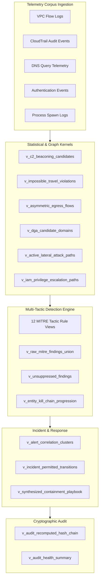

# Bastion Architecture Specification

Bastion is an autonomous Zero-Trust Identity Graph, real-time threat detection engine, lateral movement graph traversal kernel, and forensic telemetry ledger implemented in pure ANSI SQL.

```
                           +----------------------------------------+
                           |       Enterprise Telemetry Ingress     |
                           |  (VPC Flow, CloudTrail, DNS, Processes)|
                           +-------------------+--------------------+
                                               |
                                               v
                           +----------------------------------------+
                           |       Core Relational Data Catalog     |
                           |   (Entities, Principals, Graph Nodes)  |
                           +-------------------+--------------------+
                                               |
                    +--------------------------+--------------------------+
                    |                          |                          |
                    v                          v                          v
       +-----------------------+  +-----------------------+  +-----------------------+
       |   Relational Graph    |  |  Statistical Anomaly  |  |  MITRE ATT&CK Catalog |
       |     Traversal CTEs    |  |    Inference Engine   |  |   12 Tactics / Rules  |
       | (Roles, Blast Radius) |  |  (C2, DGA, Travel)    |  |  (Brute Force, Shell) |
       +-----------+-----------+  +-----------+-----------+  +-----------+-----------+
                    |                          |                          |
                    +--------------------------+--------------------------+
                                               |
                                               v
                           +----------------------------------------+
                           | Unified Multi-Tactic Detection Engine  |
                           |    (Suppression & Campaign Scoring)    |
                           +-------------------+--------------------+
                                               |
                                               v
                           +----------------------------------------+
                           |    Incident DFA Lifecycle & Playbook   |
                           |  (State Machine & Auto-Remediation)    |
                           +-------------------+--------------------+
                                               |
                                               v
                           +----------------------------------------+
                           |  Cryptographic SHA-256 Audit Ledger    |
                           |     (Tamper-Evident Hash Chain)        |
                           +----------------------------------------+
```

## 1. Architectural Principles

1. **SQL as Computation Engine**: Bastion eliminates external graph and statistical execution frameworks. All graph algorithms (depth-first traversal, cycle guards, betweenness centrality), statistical inference models (Welford variance, Holt-Winters smoothing, Benford law chi-square), and state machines are expressed directly as declarative SQL views and recursive Common Table Expressions (CTEs).
2. **Zero-Trust Identity Invariant**: Identity accounts and network zones are presumed untrusted. Permissions are continuously resolved through effective policy unions, role chaining, explicit deny overrides, and toxic combination conflict analysis.
3. **Multi-Engine Portability**: Designed for ANSI SQL compliance, Bastion runs natively on DuckDB for embedded columnar execution and SQLite for lightweight operational environments.
4. **Forensic Immutability**: All security actions, permission adjustments, and containment directives append to an in-database cryptographic SHA-256 block ledger with pointer validation.

## 2. Directory Layout and Component Organization

The repository is structured into modular layers:

```
bastion/
├── bin/
│   └── bastion                    # Command-line entrypoint wrapper
├── bastion/                       # Python CLI and database engine harness
│   ├── engine.py                  # Multi-engine abstraction (DuckDB CLI / SQLite)
│   ├── cli.py                     # Command router and automated initialization
│   ├── generator.py               # Synthetic corpus and topology generator
│   └── visualizer.py              # ANSI terminal tables and ASCII typography
├── sql/
│   ├── schema/                    # DDL table specifications (01 to 08)
│   │   ├── 01_core.sql            # Organizations, accounts, compute assets, buckets
│   │   ├── 02_telemetry.sql       # VPC flows, auth logs, CloudTrail, DNS, processes
│   │   ├── 03_graph.sql           # Adjacency matrices, graph nodes, graph edges
│   │   ├── 04_intel.sql           # MITRE tactics, techniques, IOC fingerprints
│   │   ├── 05_analytics.sql       # Statistical baselines and anomaly stores
│   │   ├── 06_detection.sql       # Rule catalog and structured alert schemas
│   │   ├── 07_incident.sql        # DFA transitions, incidents, containment links
│   │   └── 08_audit.sql           # Cryptographic SHA-256 ledger tables
│   ├── functions/                 # Mathematical and string helper modules
│   │   ├── math_stats.sql         # Welford variance, MAD outliers, CUSUM drift
│   │   ├── holt_winters_benford.sql # EWMA decay and Benford chi-square tests
│   │   ├── string_metrics.sql     # Trigram tokenization and Jaccard similarity
│   │   └── network_cidr.sql       # IPv4 binary arithmetic and subnet containment
│   ├── graph/                     # Relational graph traversal views (01 to 06)
│   │   ├── 01_iam_effective_perms.sql  # Transitive role assumption & deny matrix
│   │   ├── 02_privilege_escalation.sql # 21 Cloud IAM escalation primitives
│   │   ├── 03_toxic_combinations.sql   # Separation of duties toxic pairs
│   │   ├── 04_lateral_movement.sql     # Recursive multi-hop lateral attack paths
│   │   ├── 05_choke_points.sql         # Intermediate transit frequency & centrality
│   │   └── 06_blast_radius.sql         # Transitive compromise exposure valuation
│   ├── analytics/                 # Statistical anomaly inference kernels
│   │   ├── beaconing.sql          # Periodic C2 beaconing coefficient of variation
│   │   ├── credential_stuffing.sql # Distributed password spray clustering
│   │   ├── data_exfiltration.sql  # Asymmetric outbound egress volume spikes
│   │   ├── impossible_travel.sql  # Haversine geodesic velocity models
│   │   └── dga_detection.sql      # Lexical Shannon entropy and vowel ratios
│   ├── entity_resolution/         # Principal and asset correlation
│   │   ├── identity_clusters.sql  # Cross-cloud human account clustering
│   │   ├── typosquatting.sql      # Domain homoglyph and edit distance analysis
│   │   └── asset_correlation.sql  # Temporal IP and MAC address stitching
│   ├── rules/                     # MITRE ATT&CK detection catalog (12 tactics)
│   │   ├── ta0001_initial_access.sql   ... ta0040_impact.sql
│   │   └── ta9999_orchestrator.sql     # Unified union and campaign progression
│   ├── incident/                  # Incident orchestration and response
│   │   ├── correlation_engine.sql # Temporal sliding window alert clustering
│   │   ├── state_machine.sql      # DFA transition rules and SLA timers
│   │   ├── timeline_builder.sql   # Chronological attack DAG reconstruction
│   │   └── playbook_synthesis.sql # Automated SQL containment synthesis
│   ├── audit/                     # Cryptographic verification
│   │   ├── hash_chain.sql         # SHA-256 block hash computation
│   │   └── tamper_detector.sql    # Discrepancy detection and health summary
│   └── seeds/                     # Synthetic test datasets (01 to 06)
├── tests/                         # Relational test suites (unit, graph, analytics, integration)
├── bench/                         # Execution benchmarks and EXPLAIN diagnostics
├── docs/                          # Comprehensive technical treatise
└── Makefile                       # Build, verification, and benchmark automation
```

## 3. Data Flow Pipeline



## 4. Subsystem Specifications

### 4.1 Recursive Graph Traversal Engine
Bastion computes transitive reachability across directed multi-graphs using recursive Common Table Expressions. The traversal engine maintains a dynamic path trail array string to guarantee acyclic evaluation:

```sql
AND INSTR(ap.full_path_trace, e.target_hostname) = 0
```

Cycle detection runs in constant amortized time per hop, preventing infinite loops while preserving path auditability.

### 4.2 Statistical Anomaly Inference
Rather than training offline black-box models, Bastion calculates closed-form statistical metrics inline:
- Inter-arrival time deltas: $\Delta t_i = t_i - t_{i-1}$
- Coefficient of variation: $CV = \frac{\sigma}{\mu}$
- Regularity threshold: $CV \le 0.15 \implies$ Periodic beaconing detected
- Haversine great-circle distance:
  $$d = 2R \arcsin \left( \sqrt{ \sin^2\left(\frac{\Delta \phi}{2}\right) + \cos(\phi_1)\cos(\phi_2)\sin^2\left(\frac{\Delta \lambda}{2}\right) } \right)$$
- Transit velocity: $v = \frac{d}{\Delta t}$ ($v > 1000\text{ km/h} \implies$ Impossible travel)

### 4.3 Incident Lifecycle Deterministic Finite Automaton
Security incidents transition through a formal deterministic state machine:

```
  [ DETECTED ] ------------> [ FALSE_POSITIVE ]
        |
        v
  [  TRIAGED ] ------------> [ FALSE_POSITIVE ]
        |
        v
  [ CONTAINED ] -----------> [ TRIAGED ] (Rollback)
        |
        v
  [ REMEDIATED ]
        |
        v
  [  RESOLVED  ] -----------> [ DETECTED ] (Recurrence)
```

Direct transition from `TRIAGED` to `RESOLVED` without containment is rejected by the relational DFA guard invariants.
